# Intro to Machine Learning and AI (CH3CO1)

## Weights and biases

$$ income = w_1 * height + b_1 $$
$$ + w_2 * income_p + b_2 $$
$$ + w_3 * rank_school + b_3 $$
$$ + w_4 * gender + b_4 $$

Find the best values of wi and bi to minimize the error, or loss
> Loss is often mean absolute error (MAE), or mean squared error (MSE).
$$ 𝑀𝐴𝐸 = |𝑖𝑛𝑐𝑜𝑚𝑒_{𝑡𝑟𝑢𝑒} - 𝑖𝑛𝑐𝑜𝑚𝑒_{𝑝𝑟𝑒𝑑𝑖𝑐𝑡𝑒𝑑}| $$
$$ 𝑀𝑆𝐸 = 𝑖𝑛𝑐𝑜𝑚𝑒_{𝑡𝑟𝑢𝑒} - (𝑖𝑛𝑐𝑜𝑚𝑒_{𝑝𝑟𝑒𝑑𝑖𝑐𝑡𝑒𝑑})^2 $$

----
$$ income_true - income_{predicted} = income_{true} - $$
$$ w_1 * heigh - w_2 * income_P - $$
$$ w_3 * rank_{school} - w_4 * gender - b $$

How to minimise loss?
> loss - $(fw_i,b_i)$
> Minimum when:
$$ \frac{d(loss)}{dw_i} = 0, \quad \frac{d(loss)}{db_i}= 0 $$

• We could do that by hand, but…
• If we have 100,000 people (or samples)?
• Solved by backpropagation.
• Can’t be done in one step, as each change to one
parameter changes the others.
• Done in a number of batches and epochs.

----

## Decision Trees

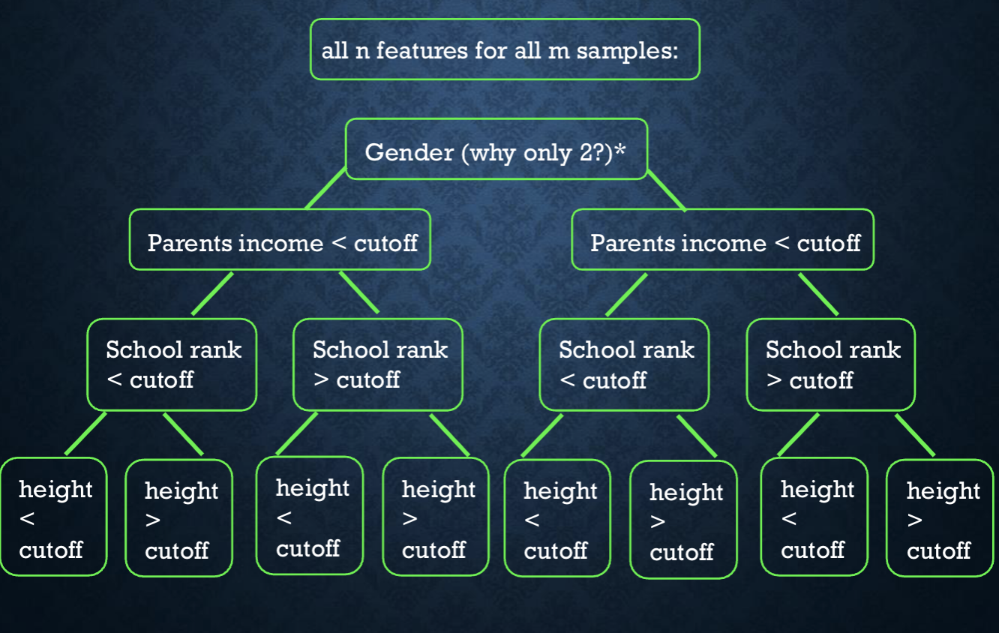

So our data is classified into these bins, what now?
### To predict a new sample:
• Billy has known values for all of the features, and is classified into bin 4
• To predict his income, we take the average income of all 14,000 samples in bin 4!

### Why did we take the reductivist view of a gender binary?
• Any current dataset you collect will likely have only binary gender or very little non-binary data.
• AI Training data is very biased!

• Decision Trees are prone to `overfitting`.
• **Overfitting**: when the model ‘memorizes’ the training data rather than ‘learning’ from it.
• An overfitted model cannot make predictions outside of the training data.

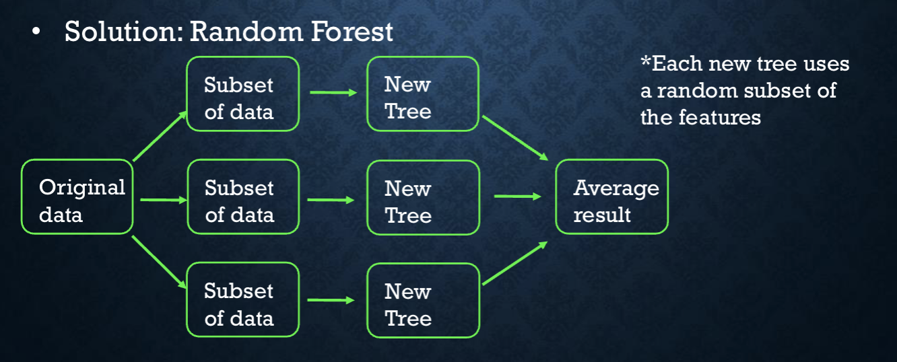

---

## Neural Networks

Revisiting the linear equation:
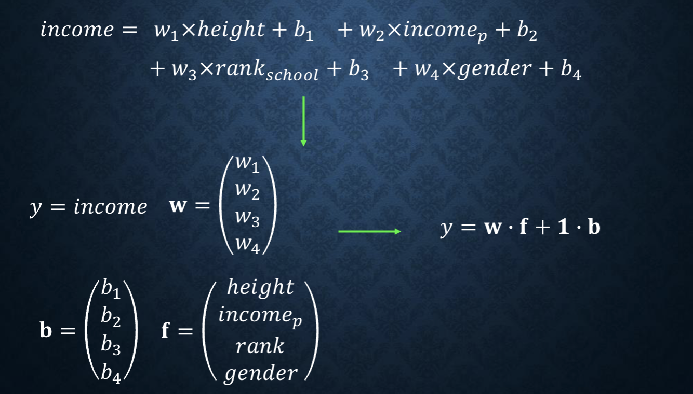

Income becomes `y` and all weights `w`, biasies `b` and features `f` get put into a vectors giving;
$$ y = w*f+1*b $$

data enters a `neuron` and is `activated`"

$$ Original Data > y_raw = w*f+b > Activation > y_act $$

>Activation is just putting the equation into another non-linear function
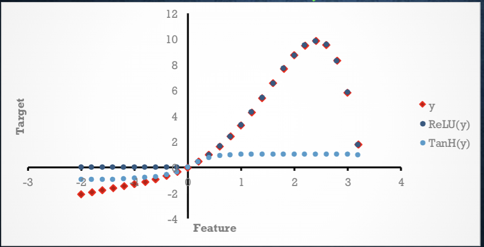

Various linear equations with varied weights and biases combined in a layer - wrapped in the same linear non-activation. When we have multiple layers the y value from the first layer is what gets input into the second layer, so on and so forth.

> One layer is a neural network, more than one is a deep neural network
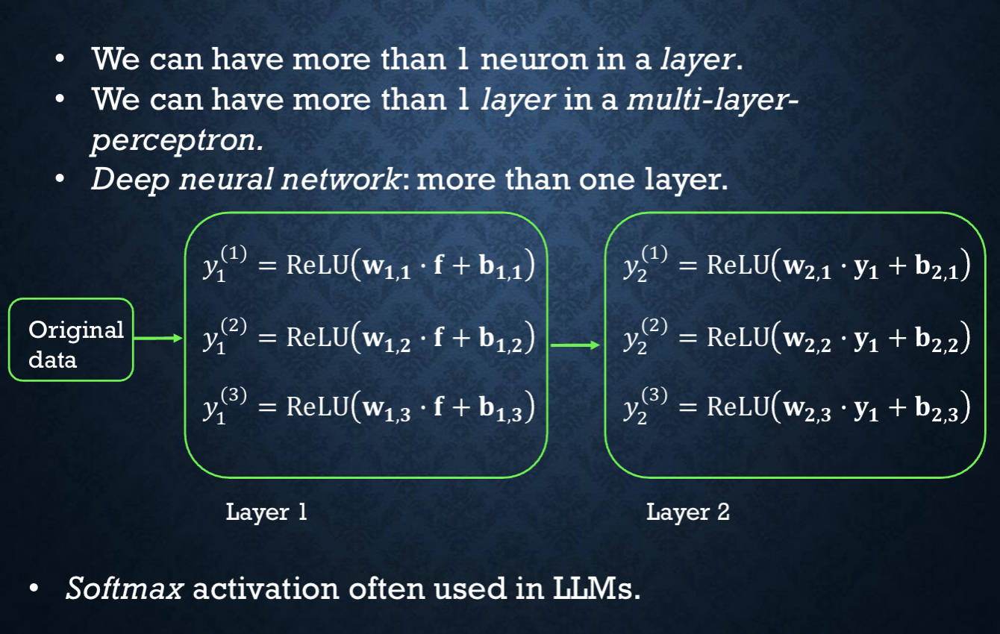

---
## Different types of neural networks

The same technique can be tailored and modified for different uses, convolutional neural networks (CNN) can be used to read images;
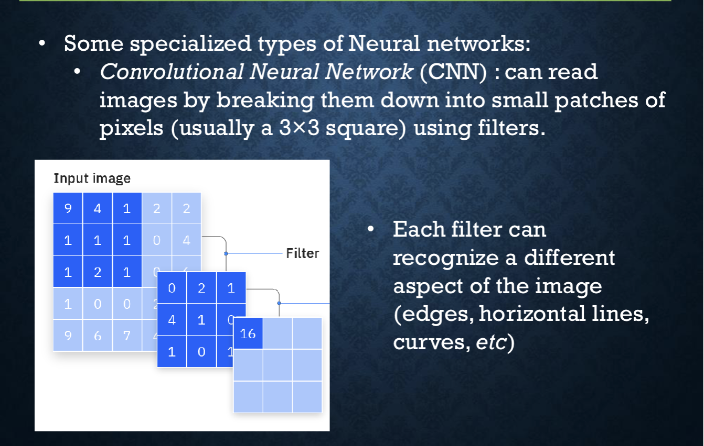

Data where the order matters, such as predicting things overtime i.e. predicting weather over a time period where it can take account of previous models predictions;
> Text can be thought of as sequential hence why it can be applied with RNNs
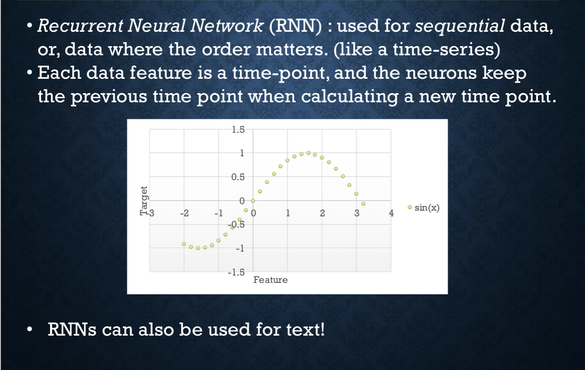

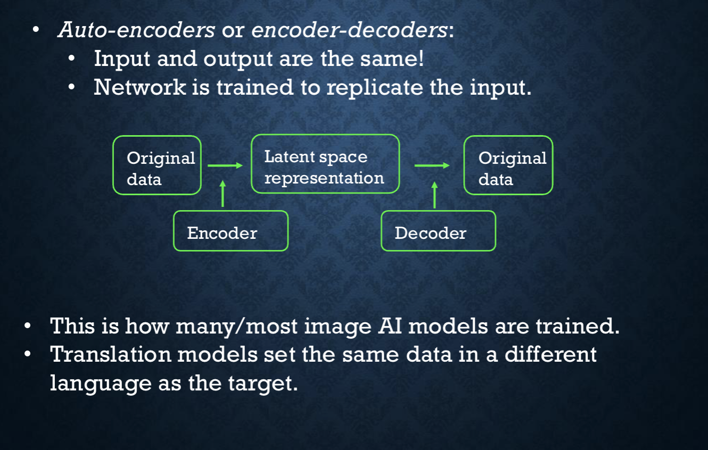
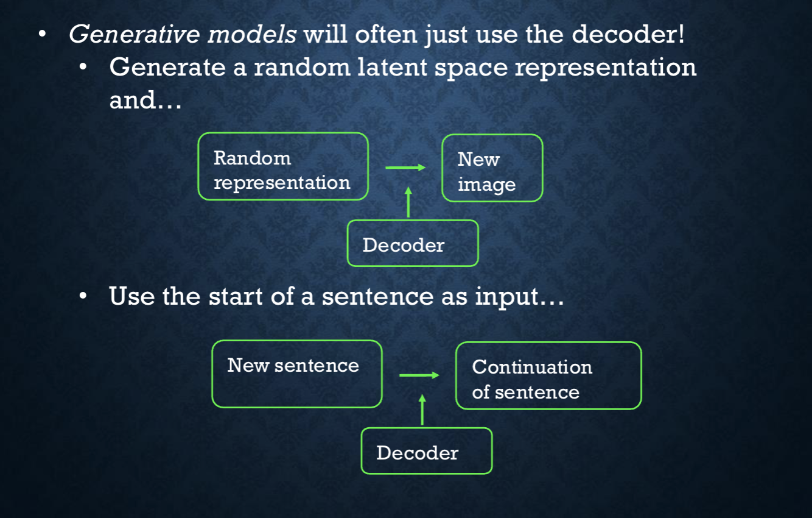

## Transformers

Are a particular type of Auto-encoders, `Attention` is a mechanism in a transformer that improves the sequence representation.

> It can relate words throughout a sentence rather then just words next to one another - this is what `Attention` does.

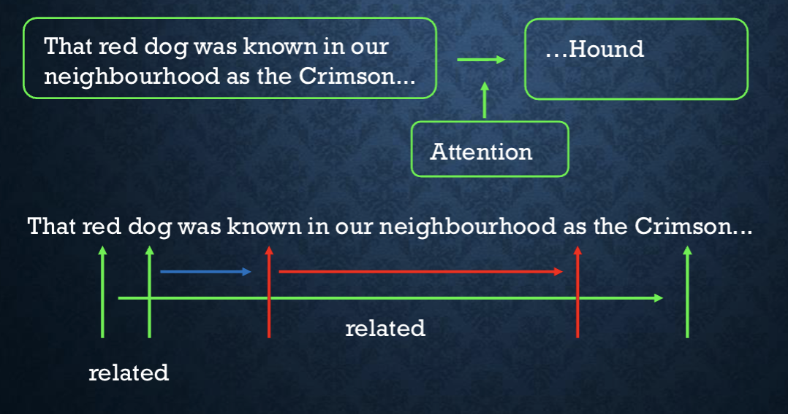

----

## GenAI

Most AI's are **Transformer-based decoders** which uses `Attention`

They are pre-trained on huge corpora of data to be able to continue the input; a GPT is this a *generative, pre-trained transformer*

They are then *fine-tuned* using reinforcement learning from human feedback (RLHF) to converse rather then just complete sentences.

## Tokenization

Large Language Models are just neural networks and need numerical inputs.

- Words are broken down into `tokens`, or parts of words
- The `Tokens` each have an assigned number

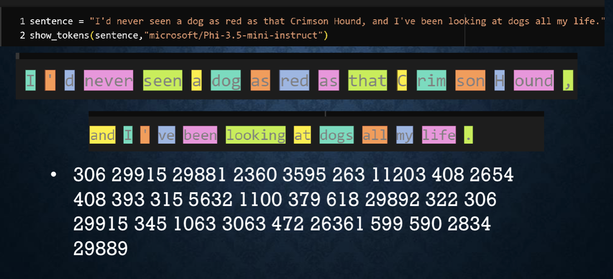

> Dog and Dogs have different tokens; I has the same token (306), this may seem counter intuitive however machines don't think/learn the same way that humans do. 

### Model Output

A tokenizer has a certain vocabulary size.
- Phi3.5-mini-instruct for example has 32,011 words in the vocabulary

The final layer in a model has a `softmax` activation, which gives the probability of each word in the vocabulary coming next in sequence.

We don't always use the *most likely* word, there are techniques to advert this.
> - Temperature Scaling
> Adjusts the "flatness" of the probability distribution. A low temperature (e.g., 0.2) sharpens the distribution, making the model highly predictable. A high temperature (e.g., 0.8+) flattens it, giving less probable words a higher chance of being picked.
> - Top-P (Nucleus) sampling
> Restricts the model's choices to only the k most likely next words. The model then redistributes the probabilities among just those k options and samples from them, completely cutting off the "long tail" of highly unlikely words.
> - Top-K sampling
> Dynamic alternative to Top-k. It accumulates the probabilities of the top words until their cumulative sum reaches a threshold p (e.g., 0.90 or 90%). The model only samples from this "nucleus" of words, allowing the pool of choices to expand or shrink depending on how confident the model is.
> - Min-p Sampling
> Sets a minimum probability threshold relative to the top token's probability. If the top token has a 60% probability and min-p is set to 0.1, any token with less than 6% probability (10% of the top token) is discarded